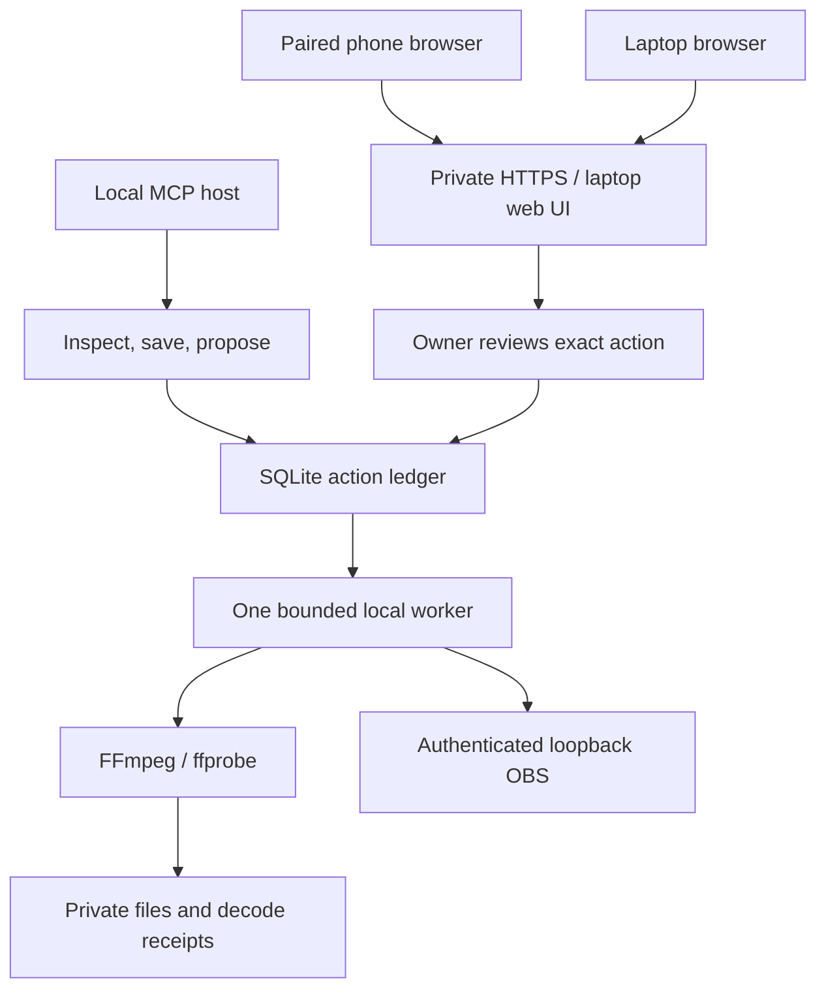

# Personal creator hub — v0.6.0

Updated November 17, 2026, America/New_York. Selected identity: EmberBanter Studio. Account plugin is a separate release, v0.5.0. See [creative suite](CREATIVE_SUITE_2026-11-17.md) for the new music, video, shell, automation and branding contracts.

The laptop owns capture and media computation. A phone is a responsive remote control paired over an explicitly configured private HTTPS origin. Local MCP access is a separate connection from the phone web app. Loading a skill does not create a device bridge.

The frontend uses framework-free ES modules/CSS and the existing Python runtime. This keeps the Windows installation usable without Node, package downloads or a JavaScript build step. Existing scene HTML and the original channel badge are preserved.

| Component | Implemented behavior |
| --- | --- |
| Service | Binds only to 127.0.0.1; validates Host and Origin. Optional explicit HTTPS proxy hostname creates no tunnel. |
| Pairing | Private random key, HttpOnly/SameSite Strict 12-hour cookies, Secure on configured HTTPS, CSRF-protected writes, limited pairing attempts. |
| Agent | Thirteen local stdio tools: previous six plus shell, projects, document read/write, workflow discovery selected-local-file import and recording-folder snapshots. No approval tool. API denies bearer approval/key retrieval. This does not isolate arbitrary programs already running as the OS user. |
| Imports | ID-scoped protected copies, SHA-256 provenance, 2 GiB upload cap and 12-hour duration cap. Artwork PNG/JPEG/WebP is limited to 20 MB/8192px and decoded before import. No browser-supplied filesystem paths or FFmpeg filter strings. |
| Edits | SQLite revision checks; up to 12 cuts and three-hour output. One source and one explicitly chosen audio track. Corrected source-timeline SRT is rebased after editing. |
| Approval | Immutable action ID/hash, three-minute expiry and one use. Changed session revisions invalidate pending export approval. |
| Jobs | One worker, at most four queued/running jobs, fresh output directory. Restart interrupts incomplete jobs and expires pending actions; no replay. OS workspace lock prevents another service recovering active work. |
| Render | Two CPU encoding threads; bounded subprocesses; file/pipe media protocols. Source checksums before/after, dimensions/duration checks, full decode and output hashes precede completion. |
| Recovery | Failed microphone import retains a browser-downloadable take and retry. Closing before saving/importing can lose that temporary take. |
| Offline | Only the application shell is cached. No media, keys, API replies or approvals. Offline mode cannot dispatch laptop jobs. |
| Publishing | No account tokens, public upload, stream start or publication endpoint. |

Added: eight-stem audio mixing, MIDI sketches, music-video waveform/motion/chroma key, versioned UTF-8 documents, named installed-app launch, fixed recipe roles, stage progress, diagnostic reports and selected brand masters. See the creative-suite capability matrix for exact boundaries.

Default workspace: `~/Documents/EmberBanterHub`, outside Git. This is a personal workstation application, not a multi-tenant cloud service or OS-level media sandbox. No malware scanner or always-on agent swarm is claimed.

Available now: import and preview compatible audio/video; reorder/duplicate/remove cuts; save/reopen edits; corrected burned captions and SRT; landscape 720p and vertical 1080p H.264/AAC; two-pass measured podcast MP3; four-second title bumper and original synthesized E4–G4–B4 motif; browser microphone takes; reviewed OBS start/stop/pause/resume, scenes, input mute and level proposals. OBS needs the privately configured password and actual acceptance. Scene/mixer changes affect an already-live broadcast; this hub cannot start one.

## SONARA adoption and provenance

Inspected read-only at `famouslytrill-boop/sonara-os@1693036c4e50b6b4d15db5b4943752cac5552b6d`. No SONARA systems, code, protections, deployments, databases or credentials changed.

| Source | Adaptation | Evidence boundary |
| --- | --- | --- |
| `.ai/shared/DESIGN_CONTRACT.md`, `docs/design/MOBILE_LAYOUT_RULES.md` | 12px geometry, readable controls, focus/touch sizing, token colors and reduced motion. | EmberBanter keeps its own palette and badge. |
| `.claude/skills/designing-governed-product-workflows/SKILL.md` | Visible control → validation → durable state → useful result/error. | Instructions do not grant device authority. |
| `lib/sonara-media-render-receipt.cjs` and tests | Separate checksums, actual execution, full decode, rights and editorial review. | SONARA's verifier is inspection-only. This hub independently executes FFmpeg. |
| `lib/sonara-agent-skill-strategies.cjs` | Bounded planner/executor, narrow tools, independent output checks and no agent approval tool. | No autonomous hosted runtime was imported. |
| `lib/sonara-formula-library.cjs` | Tested Python media arithmetic exposed through local MCP. | Missing measured speed remains unknown. |
| Existing studio v0.3.0 | Tested SRT/ASS writer, OBS authentication proof, two-pass MP3 routine and scene graphics. | Synthetic evidence does not establish real microphone/Xbox quality. |

Equations: `duration = frames / fps`; `MiB = bitrate_bits_per_second × seconds / (8 × 1048576)`; `render_seconds = frames / measured_fps + overhead`. Units are explicit. Payload excludes container overhead and does not predict variable CRF output exactly. No render ETA is invented without measured speed. Existing subjective clip scoring and missing-data-safe economics remain unchanged.

## Broadcast extension

The [v0.6 contracts](BROADCAST_0.6.0.md) add a scoped recording inbox, reviewed stable-copy ingestion, stream-hash verified MP4 remux, multi-source episode/chapter assembly, audio companions and an installed portable Audacity editor. Public brand focus is gaming, streaming, podcasts and video/audio editing; Music. Games. Stories. remains.

## Next extensions

1. Pair Dam's real phone over private HTTPS; test reconnect, expired sessions, downloads and Add to Home Screen. Tailscale Serve is the researched option, still unconfigured.
2. Configure OBS password privately; verify reviewed controls in a deliberate rehearsal. Test actual microphone/interface, Xbox picture/game sound, party consent, BRB silence and sync.
3. Extend the existing cut editor to multitrack/keyframe timelines and transitions. Separate v0.5 workflows now mix stems and compose music videos with waveform/chroma key; they do not create a full general timeline.
4. Integrate transcription jobs from the existing whisper.cpp/Shotcut workflow after a real-voice benchmark. No silent model download.
5. Connect per-provider OAuth/private drafts, then publishing approval and reconciliation receipts. A hosted authenticated MCP relay needs device identity, pairing and revocation before ChatGPT mobile can control the laptop directly.

This milestone is not a finished general DAW, complete nonlinear editor, cloud service or connected publishing system.

Primary references: [OBS protocol](https://github.com/obsproject/obs-websocket/blob/master/docs/generated/protocol.md), [FFmpeg filters](https://ffmpeg.org/ffmpeg-filters.html), [MCP transport](https://modelcontextprotocol.io/specification/2025-06-18/basic/transports), [MCP tools](https://modelcontextprotocol.io/specification/2025-06-18/server/tools), [Tailscale Serve](https://tailscale.com/docs/features/tailscale-serve).
