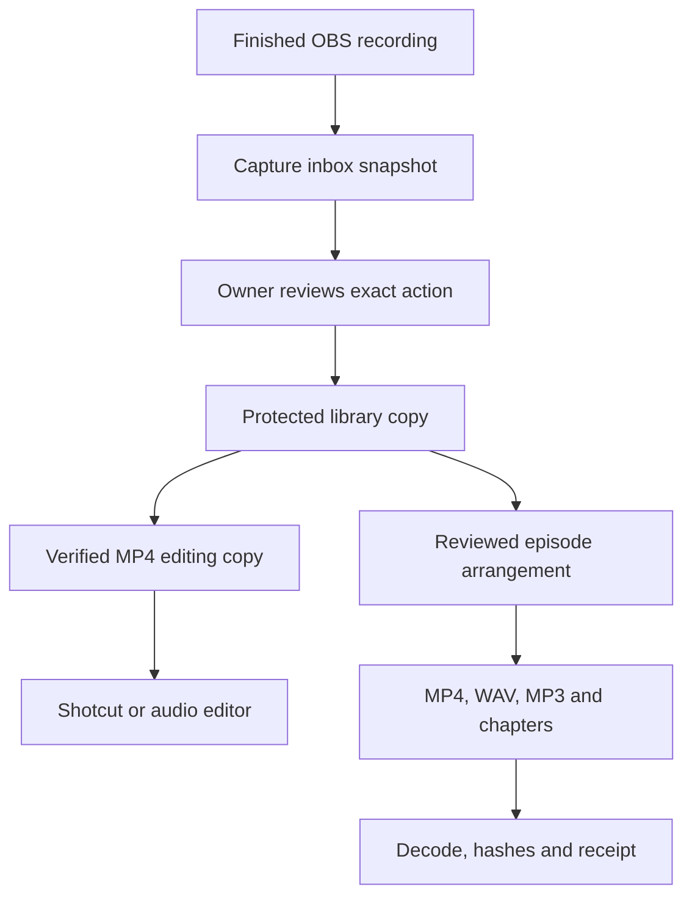

Current brand supersession: the 0.7.0 kit now labels Gaming, Streaming and Podcasts only. Editing remains an application feature. See [creative control](creative-control.md).

# EmberBanter broadcast workflows — v0.6.0

November 17, 2026, America/New_York. Account plugin source v0.5.0.

Brand direction: **Gaming, Streaming, Podcasts, Video + Audio Editing.** Keep **Music. Games. Stories.** and **Clock out. Queue up.** The revised identity board removes music-production/music-video category labels and replaces the release graphic with “New Episode Out Now.” Scene backgrounds now show a microphone/control pad. The existing EB badge and exact color tokens remain. This changes the public kit; existing optional production tools remain separate application features.

## Implemented pathways



| Workflow | Contract |
| --- | --- |
| Capture inbox | Scan one locally configured folder, nonrecursively; inspect at most 1,000 entries and return up to 50 snapshots. Supported media only, 2 GiB maximum per file, no links, paths hidden behind keyed IDs. No automatic import |
| Reviewed capture import | Require confirmation that recording has stopped. Pin size, modification time, device/inode and name; reject recent files. Compare source/copy SHA-256 and final stat. Reject active OBS recording when authenticated OBS status is configured. Remove an unverified imported copy if the source changes during copying |
| Editing copy | Compatible H.264/HEVC/AV1 and AAC/ALAC/MP3 recording → new MP4 using stream copy. Preserve selected video and every audio track. Compare per-stream compressed-packet hashes, fully decode the result and preserve original-file checksums. Unsupported codecs fail clearly; no silent transcode |
| Episode | Arrange 1–12 segments from multiple imported sources, up to one hour. Each segment has source, trim, chapter label, selected audio track and gain. Reorder, duplicate or remove. Video delivery requires audio and video in each segment; podcast mode supports audio-only recordings |
| Audio finish | 24-bit stereo 48 kHz WAV plus measured MP3, two-pass normalization, target -24 to -14 LUFS. Optional fixed 80 Hz high-pass, 16 kHz low-pass and 2:1 compression; this is gentle processing, not distortion repair or complete noise removal |
| Delivery | MP4 for video episodes; WAV/MP3 audio companions; actual MP4 chapter metadata, chapters JSON/FFmetadata, optional reviewed captions using final episode time, recipe, full-decode/hash receipt and delivery ZIP below the existing 500 MB ZIP budget |

An unchanged five-second file snapshot does **not** prove recording stopped. The user must finish/stop OBS and review the selected file before import. If OBS authentication is configured but unavailable, its import check fails. Source metadata, subtitle/data streams and old chapters are omitted from an editing copy; episode chapter labels are newly authored. Native editor/project compatibility still needs a real round trip.

Core authority remains: paired cookie/CSRF owner controls, bearer tools cannot approve, exact immutable three-minute proposals, one use, one worker and four active/queued jobs. Restart interrupts incomplete work without automatic replay. The new workflows do not start streams, publish, install plugins into OBS, alter OBS settings or record hardware by themselves.

## Open and use

Dashboard → **Capture inbox** → Scan after finishing a recording → review a selected file → approve → Build episode. **Episodes** imports additional segments, builds the order and exports through review. Capture inbox also prepares the verified MP4 editing copy and opens installed Shotcut/Audacity.

Configure a dedicated local recordings folder on the laptop, from the checkout:

```powershell
python -m tools.connect_recordings --root 'C:\YOUR\ACTUAL\OBS-RECORDINGS'
```

Use the real OBS recording directory, not that placeholder. Restart the hub after configuring it. The helper atomically saves only local connection settings outside Git and preserves other settings. A server can also use `--recordings-root`. Neither browser nor MCP can submit arbitrary filesystem roots. `recordings` in the studio shell and `studio_recordings` in local MCP list the configured snapshots. `studio_propose` supports `capture_import`, `edit_copy` and `episode`; there are now **13 local tools**.

Episode caption timestamps refer to the **arranged final episode**. Existing Studio cut-editor captions still use the original recording's timestamps. These are different explicit contracts.

## Open-source editor installation

Installed and launched **Audacity 4.0.2 x86_64 portable** on DTG. Official archive SHA-256:

`6f375602254672b4f0db959e8b1e6fd46a97462aeab85b7ff21e1e9d9a54c5b3`

The extracted `Audacity4.exe` has a valid Windows Authenticode signature from MUSECY SM LTD. Its window reported Audacity 4.0. A Podcast Audio Editor desktop shortcut was created. `scripts/install-audio-editor.ps1` reproduces the user-local portable setup with pinned download/hash and signature verification; `-Launch` opens it. No script pipe, cloud upload, paid add-on or editor-specific FFmpeg import library was enabled. Program discovery and launching do not establish a native audio edit.

OBS 33.0.1 was opened on DTG. Its WebSocket server was observed disabled with authentication enabled; no port listener was created and no OBS password was printed/copied into the repository. The file-based capture pathway can be used before remote OBS control is configured. Existing authenticated controls still require private laptop setup and real owner acceptance.

## Verification

**65 tests passed on Linux; 65 passed on DTG Windows.** New coverage includes real multi-source video/audio exports and chapter titles, two compressed audio tracks preserved during remux, changed-source failures, active-recording rejection, interrupted-copy rollback, path/link restrictions, authentication and proposal-only agent access. A chapter-metadata loss found in the first test was fixed and verified.

Actual DTG Chrome UI in a temporary private profile: unreviewed import blocked; finished synthetic capture imported; two-source episode rendered to MP4/WAV/MP3 with two chapters; editing copy preserved two audio tracks and matching compressed-stream hashes; updated brand ZIP downloaded. Capture, Episodes, Dashboard, Automation and Brand views had no horizontal overflow at 390×844 and no browser exceptions. Desktop and phone layouts were visually inspected for readable fields, source order, review controls and panel layout. Real device playback/phone capture and editorial quality are separate checks.

Synthetic media only; no physical microphone/Xbox/party recording, OBS scene/mixer/recording mutation or public distribution. Audacity/OBS window launches are verified separately from the media tests. No GitHub checks, SONARA changes, merges or production deployments were started.

## Primary research and decisions

- [OBS audio/video formats guide](https://obsproject.com/kb/audio-video-formats-guide/): resilient recording containers and editor codec compatibility support a protected recording → verified remux workflow. Existing codec settings were not changed.
- [OBS remote-control guide](https://obsproject.com/kb/remote-control-guide) and [protocol](https://github.com/obsproject/obs-websocket/blob/master/docs/generated/protocol.md): built-in authenticated WebSocket control is a separate pathway from file ingestion. Public network exposure is not required for the local hub.
- [FFmpeg filters](https://ffmpeg.org/ffmpeg-filters.html): trim/concat, rate/channel alignment, high/low pass, compression and loudness processing supply the fixed episode steps. [FFmpeg formats](https://ffmpeg.org/ffmpeg-formats.html#streamhash-1) documents the stream-hash muxer used to verify editing copies.
- [Audacity Windows download](https://www.audacityteam.org/download/windows/): official current 4.0.2 portable archive and checksum. Its availability was verified independently of installed older tools. The legacy scripting manual is not evidence that a current Audacity 4 automation API was connected.

## Next bounded integrations

1. Real microphone/interface/Xbox capture and sync rehearsal, then private phone HTTPS pairing.
2. Privately configure OBS authentication/control and verify exact recording/scene/mixer actions without weakening network restrictions.
3. Round-trip an actual episode through Shotcut/Audacity; verify native project reopening, listening and export compatibility.
4. Add reviewed replay/marker adapters, transcription after a real-voice benchmark, and per-platform private drafts with reconciled delivery receipts.

Current automation executes fixed recipes. It is not a source-rewriting agent, complete nonlinear timeline or connected publishing service.
